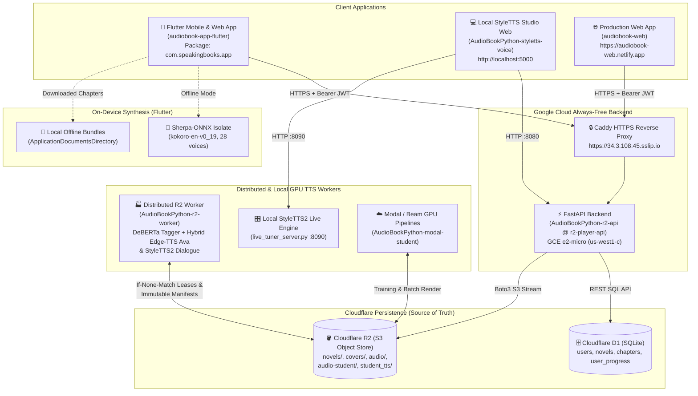

# Audiobook Ecosystem — High-Level Architecture & Change Map

> **Last Updated:** November 13, 2026  
> **Purpose:** Human-scannable visual map and AI context entry point for the Speaking Books / Audiobook Python + Flutter + Distributed TTS ecosystem.  
> **Companion Document:** See [`AUDIOBOOK_LOW_LEVEL_MAP.md`](./AUDIOBOOK_LOW_LEVEL_MAP.md) for commit hashes, file-by-file diffs, API contracts, D1 schemas, R2 key layouts, and the line-by-line root-cause & fix walkthrough for the Flutter media playback bug.

---

## 1. System Architecture at a Glance

---

## 2. Repository & Worktree Map

All repositories live under `/Users/aaggarwal/Desktop/Projects/`. The Python backend uses **Git worktrees** so production deployments, distributed GPU workers, and experimental training pipelines remain isolated.

| Directory | Repo / Type | Active Branch | Role & Status |
| :--- | :--- | :--- | :--- |
| **`AudioBookPython-r2-api`** | Python Worktree | `r2-player-api` (`13cdc33`) | **Production API branch** deployed to GCE (`https://34.3.108.45.sslip.io`). Ships via `scripts/gce/deploy.sh`. |
| **`AudioBookPython-r2-worker`** | Python Worktree | `student-tts-r2-worker` (`4abd9a2`) | **Distributed R2 Worker (`./audiobook-worker`)** for DeBERTa emotion tagging and hybrid Edge-TTS Ava + StyleTTS2 audio rendering. |
| **`AudioBookPython-student-audio`** | Python Worktree | `student-audio-api` (`f9e7b42`) | Local dev backend worktree started by `start-audiobook.sh` on port `8080`. |
| **`AudioBookPython-modal-student`** | Python Worktree | `student-tts-modal` (`33f14e9`) | Modal cloud GPU pipeline for teacher data generation, Whisper QA, and StyleTTS2 student distillation. |
| **`AudioBookPython`** | Python Main Checkout | `emotion-tagger-gpu-training` (`a99888c`) | **Dirty local research checkout** containing local Higgs/StyleTTS scripts and tagger experiments. **Do not deploy or overwrite.** |
| **`audiobook-app-flutter`** | Flutter App | `play-launch-icon-appid` | **Primary Android / iOS / Web client** (`com.speakingbooks.app`, v1.1.0+5). Replaces the legacy React Native app. |
| **`AudioBookPython-styletts-voice`** | React Web Worktree | `styletts-voice-option` (`16b553e`) | Local web player with StyleTTS voice option & owned novel deletion (port `5000`). |
| **`audiobook-web`** | React Web App | `main` | Netlify production web frontend (`https://audiobook-web.netlify.app`). |
| **`audiobook-mobile`** | React Native (Legacy) | `main` | Original React Native client (superseded by `audiobook-app-flutter` due to RN TrackPlayer / Fabric bugs). |

> [!CAUTION]
> ### Standing Operational Guardrails for AI Agents
> 1. **Never deploy from `/Users/aaggarwal/Desktop/Projects/AudioBookPython` (`emotion-tagger-gpu-training`)** — doing so will wipe the `/student-audio` routes, account deletion endpoints, and per-user novel isolation. Always deploy from `/Users/aaggarwal/Desktop/Projects/AudioBookPython-r2-api` (`r2-player-api`).
> 2. **Never run heavy/bulk jobs through the GCE `e2-micro` server** — the VM has 1 GB RAM and a strict ~$0–4/mo budget. All tagging, rendering, and bulk EPUB imports run locally or on dedicated GPU workers writing directly to Cloudflare D1/R2.
> 3. **Use the isolated gcloud configuration** — always use `CLOUDSDK_CONFIG=~/.config/gcloud-audiobook` (`speaking-books-510309`, `akshat.aggarwal9812@gmail.com`). Never touch the default gcloud profile.
> 4. **Never restart emotion tagging, run `resume.sh`, start a full-book render, or commit/push unless explicitly instructed.**

---

## 3. High-Level Map of All Changes We Have Done

### A. Python Backend & Infrastructure (`AudioBookPython*`)

| Area | High-Level Summary of Changes | Where It Lives |
| :--- | :--- | :--- |
| **1. Storage & Hosting Migration** | Migrated core persistence from Supabase + Render to **Cloudflare D1** (SQLite metadata/progress) + **Cloudflare R2** (chapter text, covers, audio) and moved the API to an **Always-Free GCE `e2-micro`** VM behind Caddy HTTPS (`https://34.3.108.45.sslip.io`). | `AudioBookPython-r2-api` (`vm-deployed` $\rightarrow$ `r2-player-api`) |
| **2. Auth Hardening & Google Sign-In** | Replaced unverified username parameters with **HMAC-SHA256 Bearer JWTs**, **bcrypt** password hashing (with legacy migration support), **case-insensitive username login** (`COLLATE NOCASE`), and **Google ID Token Sign-In & Account Linking** (`/auth/google`, `/auth/google/link`). | `app/api/user.py`, `app/core/tokens.py`, `app/core/passwords.py`, `app/core/google_identity.py` |
| **3. Play Store Compliance Endpoints** | Added self-service account deletion (`DELETE /user/account`, `POST /user/delete-account`), interactive browser deletion form (`GET /delete-account`), and public privacy policy (`GET /privacy-policy`), while protecting system accounts (`akshat`, `demo`). | `app/api/user.py` (`4ad4efb`) |
| **4. Multi-User Novel Isolation & Deletion** | Scoped `/novels` to the caller's JWT (`user_id` + public catalog), shadowed duplicate public titles when a user uploads their own copy, and added `DELETE /novel/{novel_id}` with reference-checked R2 cleanup across `novels/`, `audio/`, `covers/`, `audio-student/`, and `student_tts/`. | `app/api/novels.py`, `app/services/novel_store.py`, `app/api/epub.py`, `app/api/download_v2.py` (`02af8c5`, `13cdc33`) |
| **5. Read-Only Student Audio Streaming API** | Added `GET /student-audio/paragraph` and `GET /student-audio/{object_key:path}` to stream pre-rendered Opus (`audio/ogg`) and `manifest.json` from `audio-student/styletts2-eye-v1/<slug>/chapter_<n>/`. Enforces strict regex path validation and resolves multi-user suffixed slugs (`dune-1`). | `app/api/student_audio.py` (`358414e`, `13cdc33`) |
| **6. Distributed R2 Tagging & Audio Worker** | Built `./audiobook-worker` (`scripts/gpu_tts/student_tts/distributed/`): coordinates multi-machine/multi-process workers via R2 conditional puts (`If-None-Match: *`), 60s heartbeats, 20m lease TTL, atomic manifest-last publishing, auto-discovery of app-uploaded novels from `novels/<slug>/`, and pipelined `--stage all` execution. | `AudioBookPython-r2-worker` (`dee6762` .. `4abd9a2`) |
| **7. Hybrid Expressive Voice Pipeline (`2026-11-10.2`)** | Evolved pre-rendered audio from Higgs v3 $\rightarrow$ distilled StyleTTS2 (`kokoro_af_heart_d018` / `higgs_us_ava`) $\rightarrow$ **Hybrid `edge_ava_expressive_v1`**: narrator uses `en-US-AvaMultilingualNeural` with non-monotonic emotion/cue prosody overlapped in a background thread while the GPU renders dialogue (`default_seed2`) in StyleTTS2 batches, plus Cradle `[...]` bracket-dialogue normalization and background Opus encode/upload overlap. | `scripts/gpu_tts/student_tts/distributed/audio_render.py`, `style_plan.py`, `layout.py` (`49b9a60`, `430239d`, `4abd9a2`) |

---

### B. Flutter Application (`audiobook-app-flutter`)

| Area | High-Level Summary of Changes | Where It Lives |
| :--- | :--- | :--- |
| **1. 3-Layer Session-Safe Playback Architecture** | Built `AudiobookHandler` (`just_audio` + `audio_service`), `PlaybackCoordinator` (Riverpod orchestration), and `AudioCacheManager` (composite `(novel, chapter, index)` cache keys + `_generation` counters) to eliminate cross-chapter audio leaks and UI freezes. | `lib/services/audio_handler.dart`, `lib/providers/playback_coordinator.dart`, `lib/services/audio_cache_manager.dart` |
| **2. 4-Mode TTS Engine Selector (`Auto` / `Offline` / `Online` / `R2`)** | Added on-device **Kokoro ONNX** synthesis in a background isolate (`SherpaOnnxTtsEngine`), connectivity-gated **Online** dual-voice synthesis (`RemoteTtsEngine`), and **R2 (`TtsMode.saved`)** pre-rendered Opus streaming that appears automatically when a chapter's R2 manifest is 100% complete (`SavedChapterAudio.isChapterComplete`). | `lib/providers/tts_engine_provider.dart`, `lib/services/saved_chapter_audio.dart`, `lib/widgets/tts_mode_selector.dart` (`62de165`) |
| **3. Short-Paragraph TTS Cutoff Fix** | Enforced terminal punctuation (`_ensureTerminalPunctuation`) and appended a **250ms trailing silence pad** in `SherpaOnnxTtsEngine` so short chapter headings (`"Underlord"`, `"Chapter 16"`) do not clip before advancing. | `lib/services/tts/sherpa_onnx_tts_engine.dart` (`62de165`) |
| **4. Last-Second Pause, Notification & Earphone Replay Fix** | Fixed playback getting stuck paused when `< 1s` of a paragraph remains: separated `pauseForTransition()` from user `pause()`, guarded `_onPlayerStateChanged` against draining into `completed` while paused/interrupted, added `isNearParagraphEnd()` (`<= 1s` left) so `play()` and `decideInterruptionResume()` advance directly to the next paragraph, and reported `_isEffectivelyPlaying` so hardware earphone buttons never get stuck calling `pause()` at `completed`. | `lib/services/audio_handler.dart`, `lib/providers/playback_coordinator.dart`, `test/audio_interruption_test.dart` |
| **5. Auth, Google Sign-In & Error Separation** | Added secure token persistence (`SessionStore`), `AuthInterceptor` (signs out only on session-rejecting 401s), native Google Sign-In (`GoogleAuthService` with baked-in `GOOGLE_SERVER_CLIENT_ID`), and separated network-unreachable errors from invalid credentials. | `lib/providers/auth_providers.dart`, `lib/services/google_auth_service.dart`, `lib/services/auth_interceptor.dart` (`0a3e7f3`, `76753e4`, `859cbc8`) |
| **6. EPUB Upload, Owned Novel Deletion & Account Deletion** | Added in-app EPUB file upload, trash icon to delete user-owned novels (`isOwner`), and Play Store self-service account deletion in `ProfileScreen`. | `lib/screens/novel_list_screen.dart`, `lib/screens/profile_screen.dart` (`0a3e7f3`, `859cbc8`) |
| **7. Play Store Packaging & Home Widget** | Configured `applicationId = "com.speakingbooks.app"`, adaptive launcher icons, permission cleanup, and a debounced Android home-screen widget (`AudiobookHomeWidget`). | `android/app/build.gradle.kts`, `lib/widget/audiobook_home_widget.dart` (`bac6859`) |

---

## 4. Special Focus: The Flutter Media Playback "Last-Second Pause / Earphone Replay" Bug & Fix

> [!WARNING]
> ### What the User Experienced Before the Fix
> When listening to a chapter, if playback was paused when **only the last ~1 second of the current paragraph was left** — either because:
> 1. **A notification arrived** (transient interruption), OR
> 2. **The user deliberately paused** (from earphones or phone) and then tried to **resume from the earphone playback button** —
>
> **Previous Result:** The audio remained stuck in a paused/silent state. Pressing the earphone play/pause button did **not** resume or advance playback.

### Summary of the 5 Interacting Root Causes & Applied Fix (Nov 13, 2026)

| # | Root Cause | File | How It Was Fixed |
| :-: | :--- | :--- | :--- |
| **1** | **Last `<1s` = Already `completed` (or tail silence) in ExoPlayer** | `sherpa_onnx_tts_engine.dart` `audio_handler.dart` | Added `isNearParagraphEnd()` (`<= 1s` left past clip midpoint) so both `play()` and `decideInterruptionResume()` treat a `<= 1s` tail the same as `ProcessingState.completed` and advance to the next paragraph. |
| **2** | **`PlaybackCoordinator.playParagraph` called `await _handler.pause()`** | `playback_coordinator.dart` `audio_handler.dart` | Added `pauseForTransition()` (pauses `_player` without clearing `_wantsPlayback = false`) and moved internal transition silencing into `AudiobookHandler.playParagraph()`. |
| **3** | **`_onPlayerStateChanged` burned `_lastCompletedIndex` while paused** | `audio_handler.dart` | Guarded `_onPlayerStateChanged` auto-advance on `_wantsPlayback && !_transientInterruption`, leaving `_lastCompletedIndex` unconsumed if the last `<1s` drains to `completed` while paused/interrupted. |
| **4** | **`AudiobookHandler.play()` blindly called `_player.play()` at EOF** | `audio_handler.dart` | Tracked `_loadedIndex` and updated `play()` to reload if unloaded/idle, advance via `_triggerAutoAdvance()` if `completed` or `isNearParagraphEnd`, or play if mid-paragraph. |
| **5** | **`_emitPlaybackState` reported `playing: true` at `completed`** | `audio_handler.dart` | Used `_isEffectivelyPlaying` (`_player.playing && _player.processingState != ProcessingState.completed`) for `PlaybackState.playing` and `_shouldPauseOnToggle` in `toggle()` / `click()`. |

> [!TIP]
> **Full low-level walkthrough:** See **Section 3 of [`AUDIOBOOK_LOW_LEVEL_MAP.md`](./AUDIOBOOK_LOW_LEVEL_MAP.md)**.
