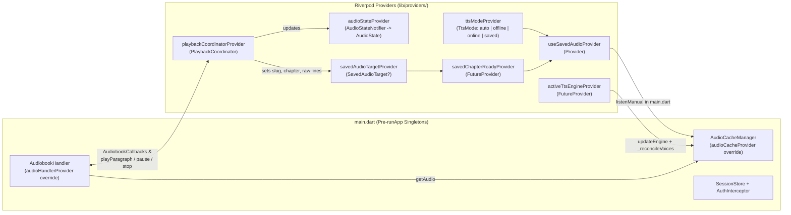

# Audiobook Ecosystem — Low-Level Technical Reference & Playback Deep-Dive

> **Last Updated:** November 13, 2026  
> **Companion Document:** [`AUDIOBOOK_HIGH_LEVEL_MAP.md`](./AUDIOBOOK_HIGH_LEVEL_MAP.md)  
> **Purpose:** Complete low-level engineering context for humans and AI agents — exact commit hashes, file paths, API routes, D1 SQL queries, R2 object schemas, Riverpod provider graphs, and a line-by-line root-cause analysis + applied fix walkthrough for the Flutter media playback functions.

---

## 1. Python Repositories & Worktrees — Low-Level Change Map

### 1.1 Worktree & Branch Inventory

```text
/Users/aaggarwal/Desktop/Projects/
├── AudioBookPython                  [branch: emotion-tagger-gpu-training @ a99888c] (DIRTY — DO NOT DEPLOY)
├── AudioBookPython-r2-api           [branch: r2-player-api @ 13cdc33]               (PRODUCTION GCE DEPLOY WORKTREE)
├── AudioBookPython-r2-worker        [branch: student-tts-r2-worker @ 4abd9a2]       (DISTRIBUTED R2 WORKER)
├── AudioBookPython-student-audio    [branch: student-audio-api @ f9e7b42]           (LOCAL DEV API :8080)
├── AudioBookPython-modal-student    [branch: student-tts-modal @ 33f14e9]           (MODAL CLOUD GPU DISTILLATION)
├── AudioBookPython-styletts-voice   [branch: styletts-voice-option @ 16b553e]       (LOCAL REACT WEB PLAYER :5000)
└── start-audiobook.sh               (Starts local backend :8080, StyleTTS engine :8090, web frontend :5000)
```

---

### 1.2 Production Backend (`AudioBookPython-r2-api` — Branch `r2-player-api`)

Built on top of `vm-deployed` (`5b8900d`) and deployed to **GCE `e2-micro`** (`speaking-books-510309`, VM `audiobook-api`, `us-west1-c`, `https://34.3.108.45.sslip.io`) via `scripts/gce/deploy.sh` (which packages `git archive HEAD` + `.env`).

#### Commit-by-Commit Breakdown on `r2-player-api`

| Commit | Date | Files Modified | Low-Level Technical Details |
| :--- | :--- | :--- | :--- |
| **`358414e`** | 2026-10-29 | `app/api/student_audio.py`<br>`app/main.py`<br>`tests/test_student_audio.py` | • Mounted `student_audio.router` in `app/main.py`.<br>• Added `http://localhost:5001` to `CORSMiddleware` `allow_origins` (alongside `https://audiobook-web.netlify.app`, `http://localhost:3000`, `http://localhost:5000`).<br>• Added read-only endpoints `GET /student-audio/paragraph` and `GET /student-audio/{object_key:path}` under prefix `audio-student/styletts2-eye-v1/`. |
| **`abd67c2`** | 2026-10-29 | `app/api/user.py` | • Updated `_get_user(username)` D1 query to `SELECT id, username, password, google_sub, auth_provider FROM users WHERE username = ? COLLATE NOCASE` so mobile logins (`akshat` vs `Akshat`) match case-insensitively. |
| **`4ad4efb`** | 2026-11-04 | `app/api/user.py`<br>`tests/test_auth_endpoints.py` | • Added `DELETE /user/account` (Bearer JWT auth) and `POST /user/delete-account` (username/password form or JSON) to delete `user_progress` and `users` rows in D1.<br>• Guarded `_PROTECTED_USERNAMES = frozenset({"akshat", "demo"})` with HTTP `403`.<br>• Added `GET /delete-account` (HTML self-service deletion page) and `GET /privacy-policy` (HTML privacy policy for Google Play Console). |
| **`02af8c5`** | 2026-11-05 | `app/api/deps.py`<br>`app/api/epub.py`<br>`app/api/novels.py`<br>`app/api/user.py`<br>`app/models/schemas.py`<br>`app/services/novel_store.py`<br>`tests/test_novel_store.py` | • Scoped `GET /novels` to caller's verified JWT (`n.user_id = caller_id OR n.is_public = 1`).<br>• Shadowed public catalog novels when the caller uploaded their own book with the same title (`owned_titles` filter in `fetch_names`).<br>• Added `isOwner: bool` and `isPublic: bool` to `NovelInfo` schema.<br>• Added `resolve_novel_id(d1, name, username)` prioritizing caller-owned exact slug $\rightarrow$ caller-owned title/base-slug $\rightarrow$ public exact slug $\rightarrow$ public title.<br>• Added `DELETE /novel/{novel_id}` and `DELETE /novels/{novel_id}` restricted to `user_id == caller_id`. |
| **`13cdc33`** | 2026-11-05 | `app/api/student_audio.py`<br>`app/api/novels.py`<br>`app/api/epub.py`<br>`app/api/download.py`<br>`app/api/download_v2.py`<br>`tests/test_student_audio.py` | • Added `_resolve_caller_student_slug(slug, caller)` in `app/api/student_audio.py`: maps a base slug (e.g. `dune`) to the caller's suffixed upload (`dune-1`) and returns HTTP `404` if `slug` belongs to another user's private novel (`is_public = 0`).<br>• Extended `DELETE /novel/{novel_id}` R2 cleanup to verify no other D1 row shares an R2 object before deleting, and to purge `audio-student/styletts2-eye-v1/{slug}/`, `student_tts/novels/{slug}/`, `student_tts/coord/{slug}/`, and `student_tts/attempts/{slug}/`. |

#### Key API Endpoints & Contracts (`AudioBookPython-r2-api`)

| Method & Route | Auth | Request / Params | Response / Behavior |
| :--- | :--- | :--- | :--- |
| `POST /userLogin` | Public | `{username, password}` | Verifies bcrypt via `run_in_threadpool(verify_password, ...)`; returns `{status, username, access_token, token_type: "bearer"}`. |
| `POST /auth/google` | Public | `{idToken}` | Verifies Google ID token against `settings.GOOGLE_CLIENT_ID`; looks up by `google_sub`, auto-links matching email username, or inserts new Google user (`password = "!nopassword"`). |
| `POST /auth/google/link` | Bearer JWT | `{idToken}` | Links `google_sub` and `email` to currently signed-in password account while keeping existing password valid. |
| `DELETE /user/account` | Bearer JWT | None | Deletes `user_progress` and `users` rows for caller (403 for `akshat`/`demo`). |
| `GET /novels` | Bearer JWT | None | Lists caller's uploaded novels + public catalog (shadowing public duplicates), ordered by `MAX(up.updated_at, n.created_at) DESC`. |
| `POST /epub/upload` | Bearer JWT | `multipart/form-data` (`file`) | Parses EPUB spine/TOC, generates unique slug (`<base>` or `<base>-1` on collision), writes chapters to R2 `novels/<slug>/chapter_<n>.txt.gz`, inserts D1 `novels` + `chapters` with `user_id = caller`. |
| `DELETE /novel/{novel_id}` | Bearer JWT | Path `novel_id` (slug or title) | Deletes caller's novel from D1 (`user_progress`, `chapters`, `novels`) and purges unshared R2 keys across all novel/audio/student prefixes. |
| `POST /tts-dual-voice` | Bearer JWT + Rate Limit | `{text, paragraphVoice, dialogueVoice, speed}` | Splits text into narration vs straight-quoted dialogue (`"..."`), synthesizes via `edge-tts`, returns `audio/mpeg`. |
| `GET /student-audio/paragraph` | Bearer JWT | `?novel=<slug>&chapter=<n>&paragraph=<title\|chapter\|0..N>` | Streams `audio/ogg` Opus file from `audio-student/styletts2-eye-v1/<resolved_slug>/chapter_<n>/<file>.opus` in 64 KB chunks. |
| `GET /student-audio/{object_key:path}` | Bearer JWT | Allowlisted path under `audio-student/styletts2-eye-v1/` | Streams `manifest.json` (`application/json`) or `*.opus` (`audio/ogg`). Rejects traversal, backslashes, or non-matching prefixes with `403`. |

---

### 1.3 Distributed R2 Worker (`AudioBookPython-r2-worker` — Branch `student-tts-r2-worker`)

Located under `scripts/gpu_tts/student_tts/distributed/` and invoked via `./audiobook-worker`.

#### Commit History & Evolution (`student-tts-r2-worker`)

| Commit | Date | Summary | Key Low-Level Changes |
| :--- | :--- | :--- | :--- |
| **`dee6762`** | 2026-10-21 | Initial staged R2 worker (`4,958` lines across 43 files) | Created `leases.py` (`If-None-Match: *` claim, 60s heartbeat, 20m TTL), `tag_stage.py` (DeBERTa ensemble), `audio_stage.py`, `audio_render.py`, `audio_publish.py` (`publish.json` election + manifest-last), `validate.py`, `store.py` (`BotoStore`). |
| **`fe61d9f`** | 2026-10-29 | Upgrade to `kokoro_af_heart_d018` & full library registry | Added `--replace-stale` to overwrite older `legacy_valid` / `stale` chapters in place under `audio-student/styletts2-eye-v1/<slug>/chapter_<n>/`. |
| **`d6f0c6d`** | 2026-10-29 | Honor `AUDIOBOOK_WORKER_CACHE` | Fixed `audio_render.py` and `tagger_model.py` to respect `$AUDIOBOOK_WORKER_CACHE`. |
| **`80448a5`** | 2026-10-30 | Auto-scale CUDA batch/token budget & parallel Opus encode | Added `TAG_CUDA_DEFAULT_BATCH = 64`, `AUDIO_CUDA_DEFAULT_BATCH = 16`, `CUDA_BATCH_TOKENS = 6400`; parallelized `ffmpeg` `libopus` encoding and R2 uploads. |
| **`ed8a2fc`** | 2026-10-30 | Overlap background Opus encode + R2 upload with GPU | `audio_stage.py` & `audio_render.py` offload chapter WAV $\rightarrow$ Opus encoding (`-18 LUFS` loudnorm + `0.84` limiter) and R2 upload to a background thread while the GPU starts rendering chapter $N+1$. |
| **`017e3c4`** | 2026-10-30 | Auto-discover app-uploaded novels from `novels/<slug>/` | `registry.py` (`resolve_or_discover_novel`) scans R2 `novels/<slug>/chapter_*.txt(.gz)` and auto-registers `student_tts/novels/<slug>/source/v1/manifest.json` + `titles.json` + `index.json`. |
| **`b059d55`** | 2026-10-31 | Stream newly tagged chapters to audio workers in `--stage all` | `orchestrate.py` (`_run_all_pipelined`): when `--stage all --workers N` ($N \ge 2$) runs on untagged chapters, worker `0` runs `tag_loop` (and joins `audio_loop` once done) while workers `1..N-1` poll every 20ms (`wait_for_tags`) and immediately render chapters as soon as their tag manifests land in R2. |
| **`11bf4b0`** | 2026-11-02 | Terminal punctuation & trailing pad token in StyleTTS2 | `tts_engine.py`: appends `.` when a chunk lacks terminal punctuation and appends a trailing `0` pad token in `tokens()` so StyleTTS2 never clips the final word. |
| **`f498b79`** | 2026-11-02 | Narrator voice bank `higgs_us_ava_pp0_50st_fp0_00st_d18` | Updated runtime version `2026-11-02.1` and style bank SHA256s in `layout.py`. |
| **`ecbe7bd`** | 2026-11-05 | Multi-user same-title novel slugs in registry | `registry.py`: discovers both `novels/<base>/` and `novels/<base>-<n>/`; filters out deleted novels whose `source/v1/manifest.json` no longer exists in R2; disambiguates exact slug vs shared display title. |
| **`49b9a60`** | 2026-11-10 | Hybrid Edge-TTS Ava narrator + StyleTTS2 `default_seed2` dialogue (`2026-11-10.1`) | `audio_render.py`: routes narrator chunks (`voice == "narrator"`) to `edge-tts` (`en-US-AvaMultilingualNeural`, 24 kHz mono, `_trim_edge_silence` + linear `_level_edge_audio` at `-19.0 dB`) while keeping dialogue on GPU StyleTTS2 (`default_seed2` at `-20.0 dB`). |
| **`430239d`** | 2026-11-10 | Non-monotonic emotion/cue prosody for Edge-TTS Ava & Cradle bracket dialogue | `audio_render.py` (`_EDGE_AVA_EMOTION_PROSODY`, `_edge_prosody_for_chunk`): dynamically modulates rate (`-10%` to `+9%`), pitch (`-3Hz` to `+3Hz`), volume (`-6%` to `+6%`), dB offset (`-0.85` to `+0.65 dB`), and paragraph gap (`0.24s` to `0.55s`) using DeBERTa emotion + confidence scaling + lexical cues (`hushed`, `urgent`, `reflective`, `question`, `heading`, 3-slot neutral variation).<br>`style_plan.py`: converts Cradle-style bracketed speech/telepathy `[...]` ($\ge 2$ words, excluding `[IMAGE:...]`, `[Chapter...]`) into `“...”` so it receives dialogue voice/prosody. |
| **`4abd9a2`** | 2026-11-10 | Active voice bank `edge_ava_expressive_v1` (`2026-11-10.2`) & CPU/GPU overlap | `layout.py`: `STYLETTS_VERSION = "2026-11-10.2"`, `VOICE_BANK = "edge_ava_expressive_v1"`.<br>`audio_render.py` (`Speaker.render`): dispatches `edge_tts` network synthesis (concurrency 16) in a background `ThreadPoolExecutor` simultaneously while `student.infer_batch(...)` runs dialogue batches on the GPU. |

#### R2 Object Key Schema (`layout.py`)

```text
<R2_BUCKET>/
├── novels/<slug>/chapter_<n>.txt.gz                                      # App/EPUB uploaded raw chapter text
├── covers/<slug>.<ext>                                                   # Novel cover image
├── audio/<slug>/...                                                      # Legacy/standard TTS downloads
├── student_tts/
│   ├── novels/index.json                                                 # Registry of novels (schema: novel-index/v1)
│   ├── novels/<slug>/source/v1/
│   │   ├── manifest.json                                                 # Chapter list, byte sizes, SHA256, paragraph counts
│   │   ├── titles.json                                                   # {"1": "Chapter 1", ...}
│   │   └── chapters/<00001..N>.txt                                       # Normalized chapter text
│   ├── novels/<slug>/tags/deberta3large_teacher2+deberta3_teacher2/
│   │   ├── chapter_<00001..N>.manifest.json                              # Tag manifest (schema: tag-rows/v1)
│   │   └── blobs/<sha256>.jsonl                                          # Content-addressed per-paragraph emotion tags
│   ├── coord/<slug>/<tag|audio>/chapter_<00001..N>/lease.json            # Conditional-put worker lease (20m TTL, 60s heartbeat)
│   ├── attempts/<slug>/<stage>/<attempt_id>/chapter_<00001..N>/          # Staging area before atomic election
│   ├── styletts2-eye-v1/checkpoint/epoch_2nd_00005.pth                   # 2.25 GB StyleTTS2 student checkpoint
│   └── runtime/
│       ├── styletts2-eye-v1/2026-11-10.2/manifest.json                   # Runtime manifest + style_bank/bank.{npz,json}
│       └── emotion-tagger-v1/2026-10-20.1/manifest.json                  # DeBERTa large + base student tagger runtime
└── audio-student/styletts2-eye-v1/<slug>/chapter_<n>/                    # CANONICAL PLAYER AUDIO (unpadded chapter_<n>)
    ├── title.opus                                                        # App playbackIndex 0 (24 kHz mono 64k libopus, -18 LUFS)
    ├── 0.opus .. <M-1>.opus                                              # App playbackIndex k -> (k - 1).opus
    ├── chapter.opus                                                      # Full stitched chapter audio
    └── manifest.json                                                     # Written LAST to mark chapter complete (schema: student-audio/v1)
```

---

## 2. Flutter Repository (`audiobook-app-flutter`) — Low-Level Change Map

### 2.1 Branch & Commit History (`play-launch-icon-appid`)

| Commit | Date | Summary | Key Files & Symbols Changed |
| :--- | :--- | :--- | :--- |
| **`c2323c8`** | 2026-08-06 | Offline on-device TTS (Kokoro), voice picker, model download | `lib/services/tts/sherpa_onnx_tts_engine.dart`, `tts_model_manager.dart`, `kokoro_voices.dart`, `dual_voice_segmenter.dart`, `wav_encoder.dart` |
| **`af4f343`** | 2026-08-07 | Eliminate chapter-switch audio leak with session-scoped playback | `AudioCacheManager` composite `_CacheKey = (String novel, int chapter, int index)` + `_generation`; `AudiobookHandler._generation` + `_isCurrent(gen, paragraphIndex)` |
| **`5b2cc6d`** | 2026-08-07 | Narrow provider watches, de-dup mini player, bound reader keys | `ReaderScreen` `.select()` watches + `_pruneItemKeys` (max 80 `GlobalKey`s); `GlobalMiniPlayer` `ModalRoute.of(context)?.isCurrent` check |
| **`4ec1aae`** | 2026-08-07 | Gate remote TTS on connectivity, handle audio-session interruptions, validate synth output | `RemoteTtsEngine.isAvailable()` via `connectivity_plus`; `AudiobookHandler._wireAudioSessionEvents()`; `AudioCacheManager` `> 1024` byte check |
| **`12ba28e`** | 2026-08-08 | Online voice picker, engine choice toggle, faster preload | `TtsModeSelector` (`auto`, `offline`, `online`), `OnlineVoicePicker`, `_reconcileVoicesForEngine` in `main.dart`, `maxConcurrentPreloads = 3` |
| **`2ebd260`** | 2026-10-01 | First attempt at interruption fix near paragraph end | Added `decideInterruptionPause` / `decideInterruptionResume` and `_triggerAutoAdvance()` in `lib/services/audio_handler.dart` |
| **`0a3e7f3`** | 2026-10-01 | Ebook upload, token-based auth, and Google sign-in/linking | `SessionStore`, `AuthInterceptor`, `GoogleAuthService`, EPUB upload in `NovelListScreen` |
| **`81c7851`** | 2026-10-02 | Drop runtime backend picker; use single GCP backend | `lib/services/api_client.dart`: hardcoded default `https://34.3.108.45.sslip.io` |
| **`76753e4`** | 2026-10-02 | Only sign out on 401s that reject the current session | `AuthInterceptor`: checks if request token matches `sessionStore.current?.token` and ignores `/userLogin` / `/auth/google` 401s |
| **`f4b93bf`** | 2026-10-03 | Second attempt at interruption fix: track playback intent | Replaced `_pausedByInterruption` with `_wantsPlayback`, `_transientInterruption`, `_loadsInFlight`, and `AudioPlayer(handleInterruptions: false)` in `lib/services/audio_handler.dart` |
| **`bac6859`** | 2026-11-10 | Configure Play Store signing, `com.speakingbooks.app`, icons, permissions | `android/app/build.gradle.kts`, `AndroidManifest.xml`, `tool/icon/generate_icons.py`, `pubspec.yaml` (`1.1.0+5`) |
| **`62de165`** | 2026-11-10 | Add saved R2 chapter audio mode & fix short-paragraph TTS cutoff | `lib/services/saved_chapter_audio.dart`, `TtsMode.saved` ("R2"), `savedChapterReadyProvider`, `useSavedAudioProvider`, `SherpaOnnxTtsEngine` `_ensureTerminalPunctuation` + 250ms silence pad |
| **`859cbc8`** | 2026-11-10 | Add Google Sign-In `serverClientId`, Play Store account deletion, owned novel deletion | `GoogleAuthService` default `kDefaultGoogleServerClientId`, `AuthNotifier.deleteAccount()`, `NovelApi.deleteNovel()`, `ProfileScreen` account deletion dialog, `NovelListScreen` delete button for `novel.isOwner` |
| **Latest** | 2026-11-13 | Fix last-second pause, notification auto-resume, and earphone replay | `AudiobookHandler`: `pauseForTransition()`, `_loadedIndex`, `isNearParagraphEnd()`, `_isEffectivelyPlaying`, `_shouldPauseOnToggle`, smart `play()`, `click()` override, guarded `_onPlayerStateChanged`. `PlaybackCoordinator`: synced `isPlaying` on handler playback events. |

---

### 2.2 Complete Provider & Service Dependency Graph (`audiobook-app-flutter`)



---

### 2.3 Paragraph Indexing & Audio Resolution Order (`AudioCacheManager._loadInternal`)

> [!IMPORTANT]
> **Critical Off-By-One Invariant:**
> - `PlaybackCoordinator.loadChapter` prepends a synthetic title line: `prepared = ['Chapter N: Title', ...rawApiLines]`.
> - `ReaderScreen` strips index `0` before passing `raw` lines to `savedAudioTargetProvider` and `playChapterParagraph`.
> - Therefore, **playback index `0`** is always the **chapter title**, and **playback index `k >= 1`** maps to **backend paragraph `k - 1`**.

When `AudiobookHandler.playParagraph(paragraphIndex: k, ...)` calls `cache.getAudio(...)`, `AudioCacheManager` resolves audio in this exact order:

1. **In-Memory Cache (`_cache[(novelSlug, chapterNumber, k)]`):** Returns immediately if `isValid && paragraphText == text`, and schedules `_triggerPreload`.
2. **In-Flight Deduplication (`_activeRequests[key]`):** Awaits existing `Completer<void>` if a preload for `key` is already running in the current `_generation`.
3. **Mode 1 — Saved R2 Opus (`_useSavedAudio == true`):**
   - Calls `SavedChapterAudio.downloadParagraph(novel: novel, chapter: chapter, playbackIndex: k)` $\rightarrow$ `GET /student-audio/paragraph?novel=<slug>&chapter=<n>&paragraph=<title | k-1>`.
   - Validates magic bytes `OggS` (first 4 bytes). Writes `audio_${k}_${ts}.ogg` to temp dir (or `data:audio/ogg;base64,...` on Web). Does **not** fall through to TTS if missing (throws `StateError`).
4. **Mode 2 — Local Offline Download Bundle (`_loadOfflineBundle`):**
   - Checks `OfflineContentService.getOfflineChapterAudio(novel, chapter)` under `${ApplicationDocumentsDirectory}/downloads/{downloadId}/`.
   - Maps `k == 0` $\rightarrow$ `title.mp3`, `k >= 1` $\rightarrow$ `{k-1}.mp3` (validates file exists and size `> 1024` bytes).
5. **Mode 3 — Active `TtsEngine` (`_engine.synthParagraph`):**
   - **Offline (`SherpaOnnxTtsEngine`):** Segments text via `DualVoiceSegmenter`, ensures terminal punctuation (`_ensureTerminalPunctuation`), generates 24 kHz float samples per segment in the background isolate, applies fade (`applyFade`), appends **250ms of trailing silence** (`Float32List((sampleRate * 0.25).round())`), and encodes PCM16 WAV (`> 1024` bytes).
   - **Online (`RemoteTtsEngine`):** Checks `connectivity_plus`, then posts to `POST /tts-dual-voice` returning MP3 (`> 1024` bytes).

---

## 3. Deep-Dive: Flutter Media Playback Functions & The "Last-Second Pause / Earphone Replay" Fix

### 3.1 Inventory of Every Media Playback Function in `audiobook-app-flutter`

| Class & File | Function / Method | Caller(s) | Behavior (With Nov 13, 2026 Fix Applied) |
| :--- | :--- | :--- | :--- |
| **`AudiobookHandler`**<br>`lib/services/audio_handler.dart` | `playParagraph({paragraphIndex, paragraphText})` | `PlaybackCoordinator.playParagraph`, `AudiobookHandler.play` | Increments `_loadsInFlight`, sets `_currentIndex = paragraphIndex`, `_lastCompletedIndex = null`, `_wantsPlayback = true`. Calls `_player.pause()` internally (preserving `_wantsPlayback = true`), awaits `cache.getAudio(...)` and `_player.setAudioSource(...)`, sets `_loadedIndex = paragraphIndex`. If `_transientInterruption \|\| !_wantsPlayback`, emits state and returns without playing. Otherwise calls `unawaited(_player.play())`. |
| **`AudiobookHandler`** | `pauseForTransition()` | `PlaybackCoordinator.loadChapter` | Calls `_player.pause()` without modifying `_wantsPlayback`, so chapter transitions do not clear playback intent. |
| **`AudiobookHandler`** | `play()` | • OS `MediaSession` / Earphones (`click` / `toggle`)<br>• Notification Play button<br>• `_onInterruption` resume | Sets `_wantsPlayback = true; _transientInterruption = false;`.<br>1. If `_loadsInFlight > 0`, emits loading state and lets `playParagraph` start playback on completion.<br>2. If `_loadedIndex != _currentIndex` or `ProcessingState.idle`, calls `playParagraph` to load `_currentIndex`.<br>3. If `ProcessingState.completed` or `isNearParagraphEnd` (`<= 1s` remaining past midpoint), resets `_lastCompletedIndex = null` and calls `_triggerAutoAdvance()`.<br>4. Otherwise resets `_lastCompletedIndex = null` and calls `unawaited(_player.play())`. |
| **`AudiobookHandler`** | `pause()` | • OS `MediaSession` / Earphones (`click` / `toggle`)<br>• Notification Pause button<br>• `becomingNoisyEventStream` | Sets `_wantsPlayback = false;`, awaits `_player.pause()`, and calls `_emitPlaybackState()`. |
| **`AudiobookHandler`** | `click([MediaButton])` | Hardware headset / Bluetooth earphone media buttons | Routes `MediaButton.media` to `toggle()`, `MediaButton.next` to `skipToNext()`, `MediaButton.previous` to `skipToPrevious()`. |
| **`AudiobookHandler`** | `toggle()` | `click()`, `PlaybackCoordinator.toggle()` | Checks `_shouldPauseOnToggle` (`_isEffectivelyPlaying \|\| (_loadsInFlight > 0 && _wantsPlayback && !_transientInterruption)`). Calls `pause()` if true, else `play()`. |
| **`AudiobookHandler`** | `_onInterruption(AudioInterruptionEvent)` | `AudioSession.instance.interruptionEventStream` | On `begin`: `duck` $\rightarrow$ volume `0.3`; `pause`/`unknown` $\rightarrow$ `_transientInterruption = true; _player.pause(); _emitPlaybackState();`.<br>On `end` (`pause`): sets `_transientInterruption = false`, calls `decideInterruptionResume(wantsPlayback, loadInFlight, processingState, position, duration)` $\rightarrow$ `resume` (`play()`), `advance` (`_lastCompletedIndex = null; _triggerAutoAdvance()`), or `ignore`. |
| **`AudiobookHandler`** | `_onPlayerStateChanged(PlayerState)` | `_player.playerStateStream` | Calls `_emitPlaybackState()`. Only calls `_triggerAutoAdvance()` when `state.processingState == ProcessingState.completed && _wantsPlayback && !_transientInterruption`. |
| **`PlaybackCoordinator`**<br>`lib/providers/playback_coordinator.dart` | `_onHandlerPlayback(PlaybackState)` | `_handler.playbackState.listen` | Syncs `audioStateProvider.notifier.setIsPlaying(ps.playing)`, updates `AudiobookHomeWidget`, and throttles `progressProvider.notifier.refresh()` to 30s. |

---

## 4. Quick Command & Environment Reference for Future AI Sessions

### Local Development Stack (`start-audiobook.sh`)
```bash
# Start local backend (:8080), StyleTTS live engine (:8090), and web player (:5000):
/Users/aaggarwal/Desktop/Projects/start-audiobook.sh

# Stop all three cleanly:
/Users/aaggarwal/Desktop/Projects/start-audiobook.sh --stop
```

### Production GCE Backend (`AudioBookPython-r2-api`)
```bash
# Run backend tests (student-audio + auth + novel isolation):
cd /Users/aaggarwal/Desktop/Projects/AudioBookPython-r2-api
PYTHONPATH=. /Users/aaggarwal/Desktop/Projects/AudioBookPython-student-audio/.venv/bin/pytest

# Deploy committed HEAD of r2-player-api to GCE e2-micro (https://34.3.108.45.sslip.io):
cd /Users/aaggarwal/Desktop/Projects/AudioBookPython-r2-api
./scripts/gce/deploy.sh
```

### Distributed R2 Worker (`AudioBookPython-r2-worker`)
```bash
cd /Users/aaggarwal/Desktop/Projects/AudioBookPython-r2-worker
PYTHONPATH=. .venv-r2worker/bin/pytest tests/test_r2_worker.py scripts/gpu_tts/student_tts/distributed/tests/test_coordination.py

# Tag + render a novel (auto-discovers from R2 novels/<slug>/ if needed):
./audiobook-worker run --novel "Ghostwater" --stage all --validate
```

### Flutter App (`audiobook-app-flutter`)
```bash
cd /Users/aaggarwal/Desktop/Projects/audiobook-app-flutter
FLUTTER_ALREADY_LOCKED=true /opt/homebrew/share/flutter/bin/cache/dart-sdk/bin/dart /opt/homebrew/share/flutter/bin/cache/flutter_tools.snapshot test --no-pub --no-version-check --reporter expanded
/opt/homebrew/share/flutter/bin/cache/dart-sdk/bin/dart analyze

# Build release APK with Google Sign-In serverClientId baked in:
flutter build apk --release \
  --dart-define=GOOGLE_SERVER_CLIENT_ID=924259053419-2c2tn3gtdimqrq7tsscdge453r9r7rde.apps.googleusercontent.com
```
